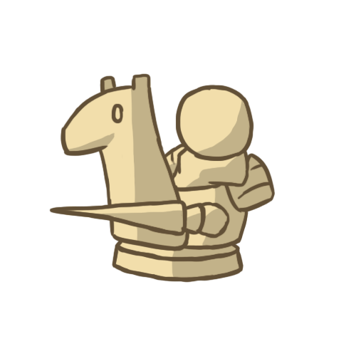
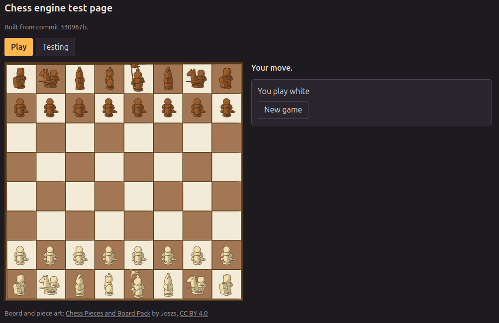

<div align="center">

  
  <h1>Chess_bot</h1>

  <p>
    A chess engine written from scratch in C++, rated about 1681 Elo against a strength limited Stockfish
  </p>

<p>
  <a href="https://github.com/Onafuwadav/Chess_bot/actions/workflows/build.yml">
    
  </a>
  <a href="https://github.com/Onafuwadav/Chess_bot/actions/workflows/web.yml">
    
  </a>
</p>

<h4>
    <a href="https://onafuwadav.github.io/Chess_bot/">Play in the browser</a>
  <span> · </span>
    <a href="https://github.com/Onafuwadav/Chess_bot/releases/latest/download/Chess_bot-windows.zip">Download for Windows</a>
</h4>
</div>

<br />

<details>
  <summary><b>Table of Contents</b></summary>

- [About the Project](#about-the-project)
- [Getting Started](#getting-started)
- [Usage](#usage)
- [Results](#results)
- [Contact](#contact)
- [Acknowledgements](#acknowledgements)

</details>

## About the Project

A chess engine written from scratch in C++ with minimax search optimised with alpha-beta pruning, move ordering, quiescence search, iterative deepening and evaluation based on piece square tables. You can play it in the browser, as a UCI engine for chess GUIs, or in the terminal. You can also run matches against Stockfish to measure its strength.

<details>
  <summary>Screenshot</summary>
<div align="center">
  
</div>
</details>

### Tech Stack

[![C++][cpp-badge]][cpp-url] [![JavaScript][js-badge]][js-url] [![HTML][html-badge]][html-url] [![GitHub Actions][actions-badge]][actions-url] [![CMake][cmake-badge]][cmake-url] [![Catch2][catch2-badge]][catch2-url] [![Emscripten][emscripten-badge]][emscripten-url] [![WebAssembly][wasm-badge]][wasm-url] 


## Getting Started

### Prerequisites
- CMake 3.16+ and a C++17 compiler. On Windows, MSYS2 (UCRT64 shell) with GCC, CMake and Ninja:

  ```bash
  pacman -S mingw-w64-ucrt-x86_64-gcc mingw-w64-ucrt-x86_64-cmake mingw-w64-ucrt-x86_64-ninja
  ```

- For Stockfish matches only: [Cute Chess](https://github.com/cutechess/cutechess) (for
  cutechess-cli) and a [Stockfish](https://stockfishchess.org/download/) `.exe` unzipped into
  `stockfish/`

### Installation
```bash
git clone https://github.com/Onafuwadav/Chess_bot.git
cd Chess_bot
cmake -S . -B build -G Ninja
cmake --build build
```

### Run Locally
| Program | What it is |
|---|---|
| `build/chess_cli.exe` | Play in the terminal |
| `build/chess_uci.exe` | UCI engine for chess GUIs and matches |
| `build/engine_tests.exe` | Perft, rules, evaluation and search tests |
| `build/engine_tests.exe "[slow]"` | Deep perft counts |
| `build/engine_bench.exe [depth]` | Search speed on four positions at set depth |


### Deployment
Done by GitHub Actions:

- **Browser version:** every push to `main` that changes `engine/` or `play/web` rebuilds the WebAssembly
  build and publishes it with [GitHub Pages](https://onafuwadav.github.io/Chess_bot/) only if the native tests and WebAssembly smoke test passes.
- **Windows release:** every push is built and tested, and pushing a version tag publishes as a GitHub Release


## Usage

### In the browser
Open https://onafuwadav.github.io/Chess_bot/

- **Play:** You play White
- **Testing:** Start at a preset position or paste own FEN, run perft against the published counts.

Another page can use this engine through `engine-worker.js`:

```js
const engine = new Worker('https://onafuwadav.github.io/Chess_bot/engine-worker.js');
engine.onmessage = (e) => console.log(e.data.bestmove);
engine.postMessage({ id: 1, fen: '', moves: 'e2e4', timeMs: 1000 });
```

### In a chess GUI
No build needed on Windows:

1. Download **[latest release](https://github.com/Onafuwadav/Chess_bot/releases/latest/download/Chess_bot-windows.zip)** and unzip it.
2. Install [ChessX](https://chessx.sourceforge.io/), or any other UCI GUI like Cute Chess then add `chess_uci.exe` from the unzipped folder and start a game against it.
3. For optional hand drawn pieces and board run `chessx-theme\install_chessx_theme.bat` then restart GUI and choose **chess-pack** for pieces and board.

`HOW_TO_PLAY.txt` in the zip has more details.

### In the terminal
Run `chess_cli.exe`. It draws the board in text. Moves are
typed as four digits `xyxy` (from square -> to square in board's coordinates shown around
the board), with an optional promotion letter, e.g. `2728n`. `h` shows help.

### Testing strength against Stockfish
[testing/match/match.ps1](testing/match/match.ps1) plays Chess_bot against Stockfish using cutechess-cli from a set of 16 openings with colours swapped estimating a rating.

[testing/match/summary.ps1](testing/match/summary.ps1) reads every file in
[testing/match/results/](testing/match/results/) and prints wins, losses and draws against each
engine at each time control.

```powershell
.\testing\match\match.ps1 -Name Chess_bot_v2 -Elo 1400,1500,1600,1700 -Games 50 -TimeControl "120+1"
.\testing\match\summary.ps1 -TimeControl "120+1"
```

May need to Bypass Execution Policy to run script if says running scripts is disabled:

```powershell
Set-ExecutionPolicy -Scope Process -ExecutionPolicy Bypass
```
<details>
  <summary><b><code>match.ps1</code> and <code>summary.ps1</code> parameters</b></summary>

#### `match.ps1`
| Parameter | Default | What it does |
|---|---|---|
| `-Name` | `Chess_bot` | Engine name to show in `results/` change per version |
| `-Elo` | `1320, 1500, 1700` | Stockfish levels to play against (1320–3190) |
| `-Games` | `20` | Total number of games to simulate per Stockfish level |
| `-TimeControl` | `10+0.1` | Clock per side, e.g. `120+1` or `40/60` |
| `-Concurrency` | `2` | Number of games to run at once, keep at maximum of half CPU cores |
| `-CuteChess` | `%LOCALAPPDATA%\Programs\Cute Chess\cutechess-cli.exe` | Path to `cutechess-cli.exe` |
| `-Stockfish` | first `stockfish*.exe` in `stockfish\` | Path to Stockfish |
| `-Engine` | `build\chess_uci.exe` | Path to your engine, point at an old copy to retest |

#### `summary.ps1`
| Parameter | Default | What it does |
|---|---|---|
| `-TimeControl` | all | Only count this time control |
| `-Engine` | all | Only show this engine (its `-Name`) |
| `-ResultsDir` | `testing\match\results` | Folder of `.pgn` files to read |

</details>

## Results
<details>
  <summary>Speed</summary>
  
Searching four preset positions to depth 4:

| Version | Positions searched | Time |
|---|---|---|
| Plain minimax | 6,088,286 | 33.8 s |
| + alpha-beta pruning | 266,203 | 1.1 s |
| + piece-square tables | 365,470 | 1.5 s |
| + MVV-LVA move ordering | 47,372 | 0.65 s |
| + quiescence search | 146,585 | 2.2 s |
| + array board (replacing `std::map`) | 146,585 | 0.61 s |
</details>


<details>
  <summary>Strength based on Games vs Stockfish</summary>
  
| Stockfish UCI_Elo | Games | W-L-D | Score | As White | As Black | Elo diff | Estimate |
|---|---|---|---|---|---|---|---|
| 1400 | 50 | 46-4-0 | 92% | 96% | 88% | +424 ± 316 | 1824 |
| 1500 | 50 | 36-13-1 | 73% | 77% | 69% | +173 ± 113 | 1673 |
| 1600 | 50 | 24-24-2 | 50% | 56% | 44% | +0 ± 97 | 1600 |
| 1700 | 50 | 25-24-1 | 51% | 54% | 48% | +7 ± 98 | 1707 |

**Overall estimate: 1681** over 200 games
</details>

### How Elo estimate is calculated

<details>
  <summary>Formulas</summary>

All of these come from the standard Elo model where a player rated `D` points above their opponent is expected to score:

`E = 1 / (1 + 10^(-D / 400))`

so +200 Elo expects about 76%, and 0 expects 50%.

- **Score:** points per game - win = 1, draw = ½, loss = 0.
  e.g. 36 wins, 13 losses and 1 draw is 36.5 / 50 = 73%.
- **Elo diff:** Formula above used to find `D` from score:

  `D = -400 x log10(1 / score - 1)`
  
   A 73% score gives +173.
- **± range:** 95% error margin
- **Estimate:** Opponent's rating + Elo diff, e.g. 1500 + 173 = 1673.


</details>

<details>
  <summary>How overall estimate is calculated</summary>

The rows in [Results](#results) disagree (1824, 1673, 1600, 1707) because each has its own error.
The overall estimate finds the single rating `R` that would be expected to score exactly the
points Chess_bot actually scored against all of them:

`sum over every opponent of  games x 1 / (1 + 10^((opponent - R) / 400))  =  points scored`

The script finds `R` by bisection (try a rating, check whether the expected points are too high or
too low, halve the range and repeat):

| Opponent | Games | Expected score at 1681 | Expected points | Actual points |
|---|---|---|---|---|
| 1400 | 50 | 1 / (1 + 10^(-281/400)) = 0.834 | 41.7 | 46 |
| 1500 | 50 | 1 / (1 + 10^(-181/400)) = 0.739 | 37.0 | 36.5 |
| 1600 | 50 | 1 / (1 + 10^(-81/400)) = 0.615 | 30.7 | 25 |
| 1700 | 50 | 1 / (1 + 10^(19/400)) = 0.473 | 23.6 | 25.5 |
| **Total** | **200** | | **133.0** | **133** |


</details>


<details>
  <summary>Why 120+1 used and how much to trust the estimate</summary>

Stockfish's `UCI_Elo` setting is calibrated at a time control of 120s+1s, so that's where its labels are most accurate.

Elo is relative so it only says how a player scores against the pool it was measured in. A weakened Stockfish is also not a real 1500 player since it plays strong moves and then deliberately picks worse ones, so it blunders differently from a human or a weak engine. That makes this a useful, repeatable yardstick for comparing versions of Chess_bot, but an approximate absolute rating nonetheless.

</details>

## Contact

David Onafuwa: [LinkedIn](https://www.linkedin.com/in/david-onafuwa) · [Donafuwa@outlook.com](mailto:Donafuwa@outlook.com)

## Acknowledgements

- Chess piece and board art and the logo: [Chess Pieces and Board Pack](https://joszs.itch.io/chess-pack) by Joszs,
  CC BY 4.0 (see [play/gui-theme/CREDITS.md](play/gui-theme/CREDITS.md)).
- Piece square tables: Tomasz Michniewski, *Simplified Evaluation Function*
  ([chessprogramming.org](https://www.chessprogramming.org/Simplified_Evaluation_Function)).
- Referenced Perft counts: [chessprogramming.org](https://www.chessprogramming.org/Perft_Results).


<!-- Tech stack badges -->
[cpp-badge]: https://img.shields.io/badge/C%2B%2B17-00599C?style=for-the-badge&logo=cplusplus&logoColor=white
[cpp-url]: https://isocpp.org/
[cmake-badge]: https://img.shields.io/badge/CMake-064F8C?style=for-the-badge&logo=cmake&logoColor=white
[cmake-url]: https://cmake.org/
[catch2-badge]: https://img.shields.io/badge/Catch2-2E3440?style=for-the-badge
[catch2-url]: https://github.com/catchorg/Catch2
[actions-badge]: https://img.shields.io/badge/GitHub_Actions-2088FF?style=for-the-badge&logo=githubactions&logoColor=white
[actions-url]: https://github.com/features/actions
[emscripten-badge]: https://img.shields.io/badge/Emscripten-4B4B4B?style=for-the-badge
[emscripten-url]: https://emscripten.org/
[wasm-badge]: https://img.shields.io/badge/WebAssembly-654FF0?style=for-the-badge&logo=webassembly&logoColor=white
[wasm-url]: https://webassembly.org/
[js-badge]: https://img.shields.io/badge/JavaScript-F7DF1E?style=for-the-badge&logo=javascript&logoColor=black
[js-url]: https://developer.mozilla.org/en-US/docs/Web/JavaScript
[html-badge]: https://img.shields.io/badge/-HTML-E34F26?style=for-the-badge&logo=html5&logoColor=white
[html-url]: https://developer.mozilla.org/en-US/docs/Web/HTML
